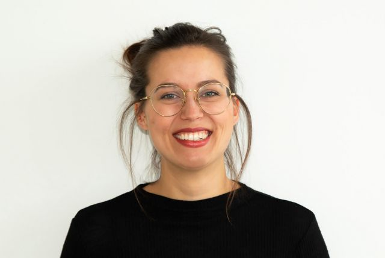

# [IEEE VIS Panel] Molecules to Humankind: Challenges in Multiscale Visualization

Andreas Bueckle1, Christiane V. R. Hütter2,3, Jörg Menche2,3,4,5, Katy Börner1,6

1 Department of Intelligent Systems Engineering, Luddy School of Informatics, Computing, and Engineering, Indiana University, Bloomington, IN, USA\
2 Ludwig Boltzmann Institute for Network Medicine, University of Vienna, Vienna, Austria\
3 Department of Structural and Computational Biology, Max Perutz Labs, University of Vienna, Vienna, Austria\
4 CeMM Research Center for Molecular Medicine of the Austrian Academy of Sciences, Vienna, Austria\
5 Faculty of Mathematics, University of Vienna, Vienna, Austria\
6 CIFAR MacMillan Multiscale Human, Canadian Institute for Advanced Research (CIFAR), Toronto, ON, Canada

# Time and Date
**Room**: Hall America South\
**Time**: Tuesday, Nov 10 @ 13:00 - 14:30 (US/Eastern)

IEEE VIS website: [https://ieeevis.org/year/2026/program/session/v-panels-panel1](https://ieeevis.org/year/2026/program/session/v-panels-panel1)

# Description of the Panel Topic

***Fig. 1**. Multiscale, numbered reference axis across more than 10 orders of magnitude, from molecules to the human body and beyond. Representative objects at each scale provide visual context; colored markers indicate the primary spatial scales in each panelist's research, incl. ranges. We will utilize this figure as a printed scale board with a numbered reference axis for the audience exercise.*

Life unfolds in three dimensions, but much of what drives it remains invisible to the naked eye. From drug molecules through tissues and organ systems, understanding the human body requires traversing 10 orders of magnitude. Data visualization and 3D interactive user interfaces can help explore and communicate this complexity in support of multiscale reference atlas construction and precision modeling that support precision health and medicine.

Filling a gap in prior years' IEEE VIS programs, our panel will synthesize relevant and emerging themes within the visualization community. Based on our panelist's expertise, we introduce a spectrum of visualization challenges, such as traversing scales without losing context, bridging diverse layers of information, and visual transitions. We recognize that multiscale visualization is an active research topic for which the community has not had a high-profile venue to synthesize its lessons.

To address this gap, our panel brings together five experts from science (astrophysics, computer science, bioinformatics, molecular biology) and computing (machine learning, graphics, data visualization, computational media, scientific visualization) to examine the state-of-the-art in multiscale data visualization for exploration and communication which must remain coherent, interpretable, and actionable across every level of scale. Our panelists will briefly present their own work, then engage in a moderated discussion on areas of disagreement, unresolved challenges, and competing design philosophies. Rather than seeking consensus, the panel will deconstruct existing work from each panelist's research and directly compare alternative approaches to visual language, interaction design, scale transitions, and information density. Drawing on examples from multiple disciplines, the discussion will examine where current approaches converge, where they conflict, and what questions remain open for the wider visualization community. Panelists will be encouraged to articulate where their approaches diverge and to discuss the trade-offs underlying different solutions. Through concrete examples, we will identify both transferable principles and productive areas of disagreement for the broader IEEE VIS community.

For audience engagement, we will bring the scale board with a numbered reference from Fig. 1 as a large print; it is inspired by the [NikonUniverscale](https://www.nikon.com/company/corporate/sp/universcale/). We will invite all attendees to put pins and strings on the printed scale board to create lines highlighting the spectrum of data scale(s) at which they work, or to place pins at specific indivpport documentation of the visualization community and experts of diverse domains who are attending and actively contributing to the panel. 

# Short Description of the Panel Format and Anticipated Schedule
To avoid running this panel as a mere sequence of talks, panelist will only speak for 5 minutes each. An audience exercise will involve attendees indicating the data scale(s) they work at by putting pins on the printed scale board with a numbered reference axis representing different powers of 10. Also, we will encourage participants to state the data scale at which they typically work when introducing themselves (a spin on the common practice to state one's name and institutional affiliation). The 90-minute panel will consist of:

1. **Welcome and introduction (5 min)** by panel chairs;
2. **5-minute talks by panelists (30 min)** with transition time;
3. **Panel discussion (30 min):** The panel discusses the presented work and addresses questions from the audience;
4. **Audience exercise (10 min):** Audience members place pins into the scale(s) at which they work on the printed scale board with a numbered reference axis with powers of 10 (see Fig. 1). If they work on multiple scales, they will be able to set multiple pins and connect them with yarn;
5. **Panel discussion and reflection (10 min):** The panel reviews the audience responses and discusses emerging patterns and insights;
6. **Conclusion (5 min)** with key takeaways.

# List of Panelists

**Alyssa Goodman, Ph.D.**, Robert Wheeler Willson Professor of Applied Astronomy, Harvard University; Research Associate, Smithsonian Institution. **Email:** [agoodman@cfa.harvard.edu](mailto:agoodman@cfa.harvard.edu). **Web:** [https://astronomy.fas.harvard.edu/people/goodman-alyssa](https://astronomy.fas.harvard.edu/people/goodman-alyssa). **Expertise:** Astrophysics, science education, data science & visualization, prediction. Aims to understand how interstellar gas arranges itself into new stars and on new techniques for measuring the structure of the Galaxy. Leader and founder of several efforts that use the WorldWide Telescope software to help teach science, and to make discoveries about the Universe. Leads the effort of creating the high-dimensional linked-view exploratory data visualization software "glue," as well as the HarvardX course called "PredictionX," which traces the history of prediction from ancient times to modern simulations.

**G. Elisabeta (Liz) Marai, Ph.D.**, Professor of Computer Science, University of Illinois Chicago, and a designated University of Illinois Scholar. **Email:** [gmarai@uic.edu](mailto:gmarai@uic.edu). **Web:** [http://gemarai.xyz](http://gemarai.xyz). **Expertise:** Educator, scientist, researcher, inventor. Interdisciplinary research, with particular emphasis on computation in the life sciences. Researches human-centered data science with a focus on visual computing and analysis, an area of computer science that handles images, 2D and 3D models, and the interaction between humans and data that can be represented visually. Founder and Director of the UIC Institute for Health Data Science Research.

**Angus G. Forbes, Ph.D.**, NVIDIA (Senior Scientist, NVIDIA AI Technology Center). **Email:** [aforbes@nvidia.com](mailto:aforbes@nvidia.com). **Web:** [https://angusforbes.com](https://angusforbes.com). **Expertise:** Interdisciplinary research in graphics, visualization, and AI systems; recent projects include the creation of interactive tools for visualizing large simulation datasets, bio-inspired approaches to data reconstruction, and neural rendering architectures for temporally stable real-time denoising and supersampling. Interested in designing interfaces and developing interaction techniques that augment our ability to reason about complex datasets and to facilitate effective data analysis.

**Han-Wei Shen, Ph.D.**, University Distinguished Scholar and Full Professor, Computer Science and Engineering, The Ohio State University; former Editor in Chief of IEEE Transactions on Visualization and Computer Graphics. **Email:** [shen.94@osu.edu](mailto:shen.94@osu.edu). **Web:** [https://han-wei-shen.github.io](https://han-wei-shen.github.io). **Expertise:** His primary research interests are scientific visualization and computer graphics. Dr. Shen is a winner of National Science Foundation's CAREER award and the US Department of Energy's Early Career Principal Investigator Award. He also won the Outstanding Teaching award twice in the Department of Computer Science and Engineering at the Ohio State University. Dr. Shen served as the paper chair for IEEE Scientific Visualization (SciVis) 2013, 2014, the best visualization conference in the world, and is currently on the steering committee of the IEEE SciVis conference. In spring 2015, Dr. Shen was invited by the National Center for Supercomputing Application to teach an online scientific visualization course. In the summer of 2015, he was invited by Melbourne Business School at University of Melbourne to teach a data visualization course for their Advanced Business Analytics MBA program.

**Gaël McGill, Ph.D.**, Director of Molecular Visualization at the Center for Molecular and Cellular Dynamics at Harvard Medical School, Founder & CEO, Digizyme, Inc. **Email:** [mcgill@digizyme.com](mailto:mcgill@digizyme.com). **Web:** [https://ghsm.hms.harvard.edu/faculty-staff/gael-mcgill](https://ghsm.hms.harvard.edu/faculty-staff/gael-mcgill). **Expertise:** Dr. McGill's teaching and research focuses on visualization design and assessment methods in science education. He is the co-Principal Investigator for NSF's Research Collaboration Network in Undergraduate Biology Education VISABLI. Dr. McGill is also founder and CEO of Digizyme, Inc., a firm dedicated to the visualization and communication of science, and whose team comprises scientist-artists with extensive experience developing digital pedagogy informed by the cognitive psychology of learning. He is the creator of the scientific visualization portal Clarafi.com, the Molecular Maya (mMaya) software and the Multimedia Design Atlas. He also co-authored with E.O. Wilson Apple's flagship digital textbook E.O. Wilson's Life on Earth, and is an author for WW Norton’s Essential Cell Biology (7th ed.), a contributing author for Molecular Biology of the Cell (8th ed.) and a co-author on a new Introductory Biology textbook. Dr. McGill also writes on issues of biodiversity loss and sustainable engineering through his work with the United Nations and the Institute for Planetary Thinking.

# List of Organizers

**Andreas Bueckle, Ph.D.** ([https://andreas-bueckle.com](https://andreas-bueckle.com)), is the Research Lead in the Cyberinfrastructure for Network Science Center (CNS) at Indiana University. His research interest is information visualization in XR. He has a TEDx talk titled “Living and Learning in the Metaverse” (see [this YouTube video](https://www.youtube.com/watch?v=BpnLKoAK1YE)). He was awarded a R03 award (see [NIH Reporter](https://reporter.nih.gov/search/oQWN8hJ2EkWfCtqXHyTq0A/project-details/11123677)) as well as two JumpStart Fellowships ([https://hubmapconsortium.org/jumpstart-program/#andreas2024](https://hubmapconsortium.org/jumpstart-program/#andreas2024)) by the National Institutes of Health to advance multiscale exploration of the human body in VR with the HRA Organ Gallery ([https://humanatlas.io/hra-organ-gallery](https://humanatlas.io/hra-organ-gallery)).

**Christiane V. R. Hütter** is an architect and computational bioengineer as well as Ph.D. Candidate at the Ludwig Boltzmann Institute for Network Medicine, working on visual data exploration in immersive systems. Her work extends beyond disciplines, curating ([https://www.whatevr.xyz](https://www.whatevr.xyz)) and participating in various media art exhibitions ([https://ars.electronica.art/center/en/events/deep-space-experience-premiere-connected-how-the-world-is-morethan-the-sum-of-its-parts](https://ars.electronica.art/center/en/events/deep-space-experience-premiere-connected-how-the-world-is-morethan-the-sum-of-its-parts/)).

**Jörg Menche, Ph.D.**, is a professor at the University of Vienna, holding a dual appointment at the Max Perutz Labs and the Faculty of Mathematics, and is the director of the Ludwig Boltzmann Institute for Network Medicine. A physicist by training, his interdisciplinary team—spanning biology, bioinformatics, medicine, and the arts—leverages network theory to investigate molecular interactions underlying health and disease through cutting-edge technologies, from AI to VR.

**Katy Börner, Ph.D.**, is the Victor H. Yngve Distinguished Professor of Engineering and Information Science in the Department of Intelligent Systems Engineering, Core Faculty of Cognitive Science, and Founding Director of CNS at Indiana University. She leads the Human Reference Atlas effort ([https://humanatlas.io](https://humanatlas.io)), is an MPI on the Whole Person Physiome ([https://wholepersonphysiome.org](https://wholepersonphysiome.org)), and a curator of the international Places & Spaces exhibit ([https://scimaps.org](https://scimaps.org)). Börner is a Fellow of the American Association for the Advancement of Science (AAAS), a Humboldt Research Fellow, an Association for Computing Machinery (ACM) Fellow, Network Society Fellow, and a Stiftung Charité Visiting Fellow.

# Acknowledgments

This panel is made possible through support from the NIH award 1R03OD039970-01 (A.B.) and the [CIFAR MacMillan Multiscale Human program](https://cifar.ca/research-programs/cifar-macmillan-multiscale-human/) (K.B.).

# About

This companion website for the panel is maintained by the organizers. Juhi Khare contributed images.
